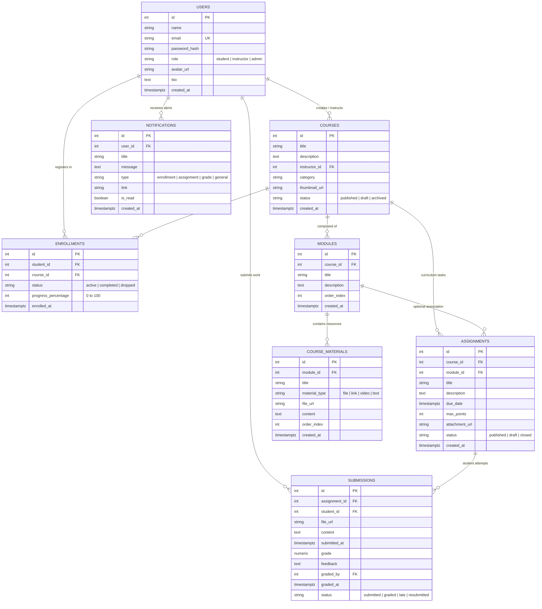

# E-Learning Management System (ELMS) — Experiment 9

A complete, full-stack, enterprise-grade E-Learning Management System implemented with a direct **PostgreSQL** relational database architecture (no ORM), **Express.js** backend with connection pooling and SQL transactions, and a modern **React (Vite)** frontend styled with **Tailwind CSS**.

---

## 📋 Technology Stack

### Frontend
- **Framework**: React.js 18+ with Vite
- **Language**: JavaScript (ES Modules)
- **Styling**: Tailwind CSS
- **Routing**: React Router v6
- **HTTP Client**: Axios with JWT Bearer Interceptors & Proxy
- **Icons**: Lucide React

### Backend
- **Runtime**: Node.js (v24+)
- **Framework**: Express.js
- **Database Driver**: `pg` (node-postgres) with `Pool` direct connectivity
- **Authentication**: JSON Web Tokens (JWT) with HTTP Bearer Authorization
- **Security**: `bcryptjs` for salted password hashing
- **File Uploads**: `multer` with disk storage and mime validation

### Database Architecture
- **Database**: PostgreSQL 18
- **ORM Policy**: **Strictly NO ORM** (No Prisma, No Sequelize, No TypeORM, No Drizzle)
- **Queries**: Manual parameterized SQL statements (`$1`, `$2`, etc.) to prevent SQL injection
- **Concurrency & Transactions**: Explicit SQL transactions (`BEGIN`, `COMMIT`, `ROLLBACK`) for atomic operations
- **Relational Integrity**: Foreign keys with `ON DELETE CASCADE` / `ON DELETE SET NULL`, `UNIQUE` constraints, and check constraints matching the UML Class Diagram

---

## 🗂️ Project Structure

```text
ELMS-Experiment9/
│
├── docs/
│   ├── SRS.pdf                         # Software Requirements Specification
│   ├── Class_Diagram.pdf               # UML Structural Class Model (Exp 3)
│   └── Sequence_Diagram.pdf            # Dynamic Sequence & Collaboration Model (Exp 4)
│
├── frontend/
│   ├── public/                         # Static assets and icons
│   ├── src/
│   │   ├── components/
│   │   │   ├── common/                 # Navbar, Sidebar, Modal, Button, Badge, StatCard
│   │   │   ├── layout/                 # AppLayout, ProtectedRoute
│   │   │   ├── courses/                # CourseCard, CourseFormModal, ModuleAccordion, MaterialModal
│   │   │   └── assignments/            # AssignmentCard, AssignmentFormModal, SubmissionModal, GradingModal
│   │   ├── pages/
│   │   │   ├── auth/                   # Login.jsx, Register.jsx (with Demo Quick-Fill)
│   │   │   ├── instructor/             # InstructorDashboard, ManageCourses, CourseDetail, Submissions
│   │   │   └── student/                # StudentDashboard, CourseCatalog, CourseView, Assignments, Grades
│   │   ├── context/                    # AuthContext.jsx, NotificationContext.jsx
│   │   ├── services/                   # api.js (Axios API modules)
│   │   ├── hooks/                      # useAuth.js
│   │   ├── App.jsx                     # Application Route Matrix & RBAC
│   │   └── main.jsx                    # React Root Entrypoint
│   └── package.json
│
├── backend/
│   ├── config/
│   │   └── db.js                       # pg.Pool configuration and query helpers
│   ├── controllers/                    # Express request & response controllers
│   ├── routes/                         # Express API routes mounted under /api
│   ├── services/                       # Business logic and parameterized SQL queries
│   ├── middleware/                     # Auth, RBAC, Multer upload, and Error middleware
│   ├── uploads/                        # Stored course materials and student submissions
│   ├── database/
│   │   ├── schema.sql                  # PostgreSQL DDL for all 8 tables and indexes
│   │   ├── seed.sql                    # Plain SQL seed records
│   │   ├── seed.js                     # Node.js seed script with bcrypt password hashing
│   │   └── run-sql.js                  # Automated SQL executor utility
│   ├── app.js                          # Express app configuration & middleware pipeline
│   ├── server.js                       # HTTP server entrypoint with DB connection verification
│   ├── .env.example                    # Template environment variables
│   ├── .env                            # Active environment configuration
│   └── package.json
│
├── tests/
│   └── api-tests.js                    # Automated 17-step End-to-End verification test suite
├── screenshots/                        # Interface demonstrations
├── README.md                           # Comprehensive documentation and setup guide
└── .gitignore                          # Standard git ignore definitions
```

---

## 🗄️ PostgreSQL Database Schema

The database consists of 8 interconnected tables representing the UML Class Diagram:



---

## ⚡ Quick Start & Setup Instructions

### Prerequisites
- **Node.js** (v18 or v24+)
- **PostgreSQL** (v14+) running on `localhost:5432`

---

### Step 1: Database Setup & Non-Destructive Migrations

#### Option A: Using the Automated Node Script
From the `backend/` directory, run:
```bash
cd backend
npm run db:schema
npm run db:seed
```

#### Option B: Applying Migration 002 (Moodle Activity Completion & Grade Release)
> **IMPORTANT**: If your database is already populated, **DO NOT run schema.sql or seed.sql** because they contain `DROP TABLE` and `TRUNCATE`. Instead, run the non-destructive migration:
```bash
cd backend
node database/run-sql.js database/migrations/002_activity_completion.sql
```
This safely creates:
- `activity_completions` table with unique index `(student_id, course_id, activity_type, activity_id)`
- `courses.max_capacity` (integer) and `courses.enrollment_deadline` (timestamp)
- `assignments.grades_released` (boolean default true)
- Backfills previous student submissions into completions automatically without any data loss.

#### Option C: Using `psql` Command Line
```bash
# Connect to PostgreSQL and create database
psql -U postgres -h localhost -c "CREATE DATABASE elms_db;"

# Execute schema script (initial setup only)
psql -U postgres -h localhost -d elms_db -f database/schema.sql

# Execute seed script (initial setup only)
psql -U postgres -h localhost -d elms_db -f database/seed.sql

# Apply migration 002
psql -U postgres -h localhost -d elms_db -f database/migrations/002_activity_completion.sql
```


#### Option C: Using pgAdmin 4
1. Open pgAdmin and connect to your PostgreSQL server.
2. Right-click **Databases** → **Create** → **Database...** and name it `elms_db`.
3. Right-click `elms_db` → select **Query Tool**.
4. Open and execute `backend/database/schema.sql`.
5. Open and execute `backend/database/seed.sql` (or run `npm run db:seed` from backend).

---

### Step 2: Configure Environment Variables

Create or inspect `backend/.env`:
```env
# Server Configuration
PORT=5000
NODE_ENV=development

# PostgreSQL Database Configuration
DB_HOST=localhost
DB_PORT=5432
DB_NAME=elms_db
DB_USER=postgres
DB_PASSWORD=ashwita

# JWT Authentication
JWT_SECRET=elms_secure_jwt_secret_key_change_in_production_2026
JWT_EXPIRES_IN=7d

# Frontend Client URL
CLIENT_URL=http://localhost:5173
```

---

### Step 3: Start the Backend Server

```bash
cd backend
npm install
npm run dev
```
The backend API will start on **http://localhost:5000/api**.

---

### Step 4: Start the Frontend Application

```bash
cd frontend
npm install
npm run dev
```
The React frontend will be accessible at **http://localhost:5173**.

---

## 🧪 Automated End-to-End Testing
 
A complete 21-step Moodle activity completion test suite and 17-step end-to-end suite are included:
 
```bash
# Run Moodle LMS Activity Completion & Security Test Suite
node tests/moodle-progress-tests.js

# Run Complete End-to-End Test Suite
node tests/api-tests.js
```

### Verified Moodle Activity Completion Criteria:
1. `[PASS]` Top navigation links removed, preserving sidebar access
2. `[PASS]` Instructor and student login verified with bcrypt passwords
3. `[PASS]` Student enrolls in course
4. `[PASS]` New enrollment starts at 0% with 0 completed activities
5. `[PASS]` Unauthorized resource access rejected with 403 Forbidden
6. `[PASS]` Viewing authorized resource marks resource complete (+1 count)
7. `[PASS]` Re-accessing same resource is idempotent (does not double count)
8. `[PASS]` Submitting assignment completes activity
9. `[PASS]` Resubmitting assignment is idempotent (does not double count)
10. `[PASS]` Progress persists across reloads and backend restarts
11. `[PASS]` Student A's completions are strictly isolated from Student B
12. `[PASS]` Denominator recalculates automatically when instructor adds activities
13. `[PASS]` Grade release protection hides unreleased grades from students
14. `[PASS]` Instructor toggling grade release makes grades and feedback visible
15. `[PASS]` Read-only instructor student progress roster displays accurate counts


### Verified Test Cases:
1. `[PASS]` API Health check
2. `[PASS]` Instructor login (`ashwita.pawar@elms.edu`)
3. `[PASS]` Student login (`riddhi@elms.edu`)
4. `[PASS]` Course catalog retrieval
5. `[PASS]` Course details with nested modules, materials, and tasks
6. `[PASS]` Instructor dashboard analytics
7. `[PASS]` Student dashboard progress summary
8. `[PASS]` Instructor creates a new course
9. `[PASS]` Instructor adds a curriculum module
10. `[PASS]` Instructor attaches course materials
11. `[PASS]` Instructor publishes an assignment
12. `[PASS]` Student enrolls in the newly created course
13. `[PASS]` Student submits work (file/text)
14. `[PASS]` Instructor retrieves submissions
15. `[PASS]` Instructor grades submission and attaches feedback
16. `[PASS]` Student receives grade notification
17. `[PASS]` Student updates course progress to 100%

---

## 🔑 Demo Credentials

| Role | Name | Email | Password |
| :--- | :--- | :--- | :--- |
| **Instructor** | Dr. Ashwita Pawar | `ashwita.pawar@elms.edu` | `password123` |
| **Instructor** | Prof. Alan Turing | `alan.turing@elms.edu` | `password123` |
| **Student** | Riddhi Prabhudesai | `riddhi@elms.edu` | `password123` |
| **Student** | John Doe | `john.doe@elms.edu` | `password123` |
| **Admin** | System Administrator | `admin@elms.edu` | `password123` |

> **Note**: The login screen features one-click demo auto-fill buttons for both Instructor and Student roles for rapid testing.

---

## 🚀 Implemented Modules Walkthrough

### Module 1: Course Management and Enrollment
- **Instructors**:
  - Create and edit courses with banner images, categories, and published/draft statuses.
  - Structure syllabus into ordered modules.
  - Attach lecture documents, video streams, and interactive links.
  - View real-time enrolled student rosters with progress percentages and submission statistics.
- **Students**:
  - Explore the course catalog with live keyword searching and category filtering.
  - One-click course enrollment with instant confirmation.
  - Track course progress (0% to 100%) with visual completion bars and quick milestone updates.
  - Access learning materials and download PDF handouts directly.

### Module 2: Assignment Submission and Grading
- **Instructors**:
  - Publish assignments with point limits, due dates, and supplementary reference files.
  - Review student submissions in real time with submitted timestamps, status badges, and attached files.
  - Evaluate student work with numeric score inputs (0 to max points) and detailed qualitative feedback remarks.
  - Submissions are evaluated using atomic SQL transactions that immediately dispatch notifications to the student.
- **Students**:
  - View all coursework and deadlines across enrolled courses with status indicators (`Pending`, `Submitted`, `Graded`, `Overdue`).
  - Turn in assignments with file uploads (PDF, ZIP, DOCX, code) or inline text notes.
  - View published grades, score percentages, and instructor feedback remarks in the student gradebook.

---

## 🛡️ Security & Reliability Architecture
- **Direct Database Connectivity**: Express connects via `pg.Pool` with connection pooling, avoiding ORM overhead and abstraction leaks.
- **Parameterized Queries**: All queries use `$1, $2, ...` placeholders preventing SQL injection.
- **Atomic Operations**: Grading, enrollments, and submissions execute inside `BEGIN ... COMMIT / ROLLBACK` transactions.
- **Role-Based Access Control**: Route-level protection on both backend middleware and React Router guards.
- **Token Security**: Passwords hashed with `bcryptjs` (cost factor 10); JWT stored with expiration.
